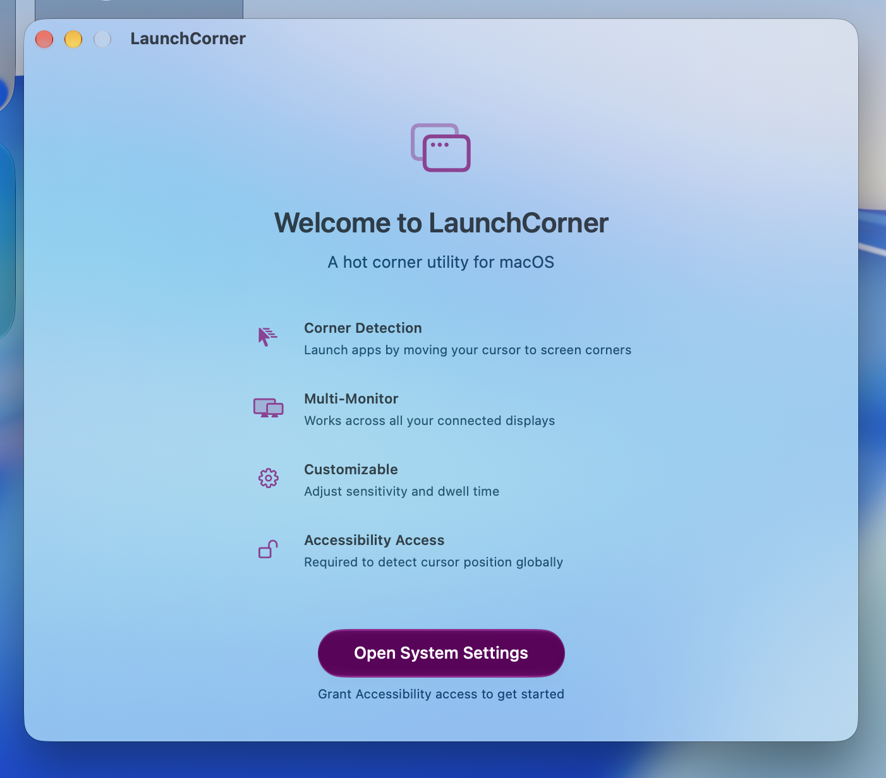
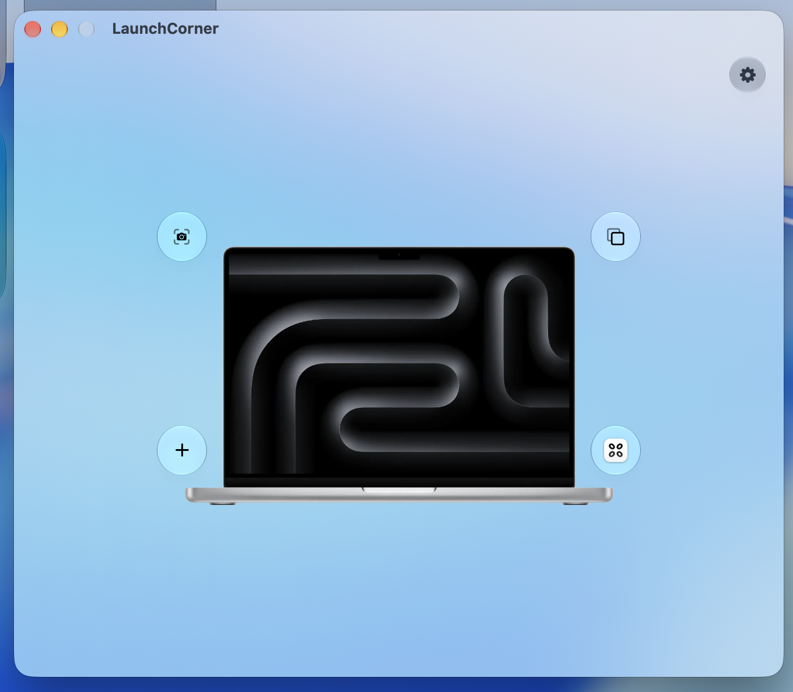
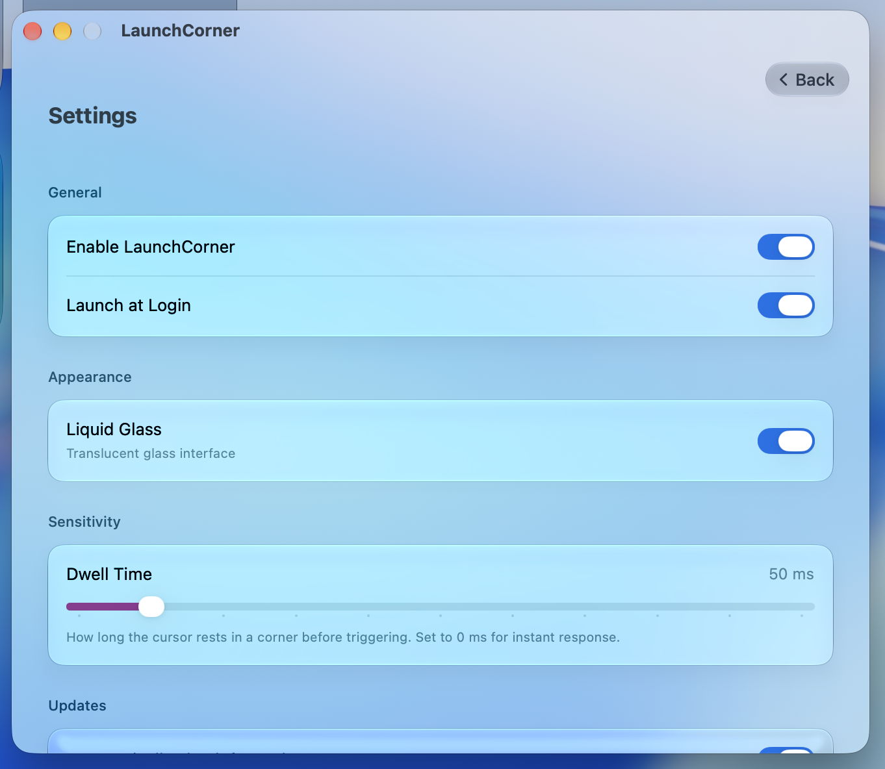

# LaunchCorner

**LaunchCorner** turns your screen corners into instant app shortcuts. Simply move your cursor to any screen corner to launch your favorite applications instantly. Built natively for macOS using SwiftUI.

---

## Why LaunchCorner?

With recent macOS updates, Apple removed the built-in Launchpad shortcut for hot corners. While great third-party alternatives exist (such as LaunchOS), many require paid upgrades just to unlock hot corner support for opening app launchers.

LaunchCorner was created as a free, open-source utility so that anyone can trigger LaunchOS (or any application) instantly via hot corners without paywalls or subscriptions.

---

## Screenshots

<div align="center">
  <h5>1. Onboarding & Accessibility Permission</h3>
  
  <br /><br />
  
  <h5>2. Main Corner Configuration</h3>
  
  <br /><br />
  
  <h5>3. Settings & Sensitivity Controls</h3>
  
</div>

---

## Key Features

- **Instant Hot Corners**: Move your cursor to any of the 4 screen corners to trigger assigned applications.
- **Native & Ultra-Fast**: Built natively with Swift & SwiftUI for zero latency and minimal CPU/memory footprint.
- **Apple Silicon (arm64)**: Native architecture for **M1/M2/M3/M4** Macs.
- **Dwell Time & Sensitivity**: Fine-tune trigger response down to **0 ms (Instant)**.
- **Multi-Monitor Support**: Works seamlessly across multiple connected displays.
- **Runs in the Background**: Starts silently at login and hides from the Dock when closed. Open the app anytime to show its window.
- **Open Source**: 100% free and open-source under the MIT license.

### Corner Actions

Each corner can trigger one of five action types (configured per corner, Liquid Glass UI on macOS 26+):

- **App** — launch any application.
- **Quick Link** — open a URL, `shortcuts://` Shortcut link, or file path, optionally with a specific app.
- **Command** — run a shell command (pick any shell from your Mac) or a script file (Bash, AppleScript, Python, JavaScript, TypeScript, Go, Ruby, C#). Script interpreters other than the built-ins install via Homebrew (e.g. `brew install node`).
- **Window** — snap the front window to a half or quarter of the display. Requires Accessibility access (already required by the app).
- **System** — Spotlight, play/pause/next/previous track, toggle light/dark, screen saver, lock screen, sleep display, Mission Control, Application Windows, Show Desktop, plus screenshots (fullscreen/selection/window → file or clipboard). Keyboard-based actions require Accessibility access; screenshots require Screen Recording access on first use.

---

## Installation

1. Download **`LaunchCorner.dmg`** from the latest [Release](https://github.com/wenujacodes/LaunchCorner/releases).
2. Double-click `LaunchCorner.dmg` to open the installer.
3. Drag **LaunchCorner** into your **Applications** folder.
4. Open **LaunchCorner** and grant **Accessibility Access** when prompted (*System Settings > Privacy & Security > Accessibility*).

> **Note**: On first launch, if prompted by macOS Gatekeeper, right-click `LaunchCorner.app` and choose **Open** (or click **Open Anyway** in *System Settings > Privacy & Security*).

---

## Building from Source

```bash
# Clone repository
git clone https://github.com/wenujacodes/LaunchCorner.git
cd LaunchCorner

# Open in Xcode
open LaunchCorner.xcodeproj
```

To generate the installer (`LaunchCorner.dmg`) locally:
```bash
./scripts/build_release.sh
```

---

## License

Distributed under the **MIT License**. Created by [@wenujacodes](https://github.com/wenujacodes).
