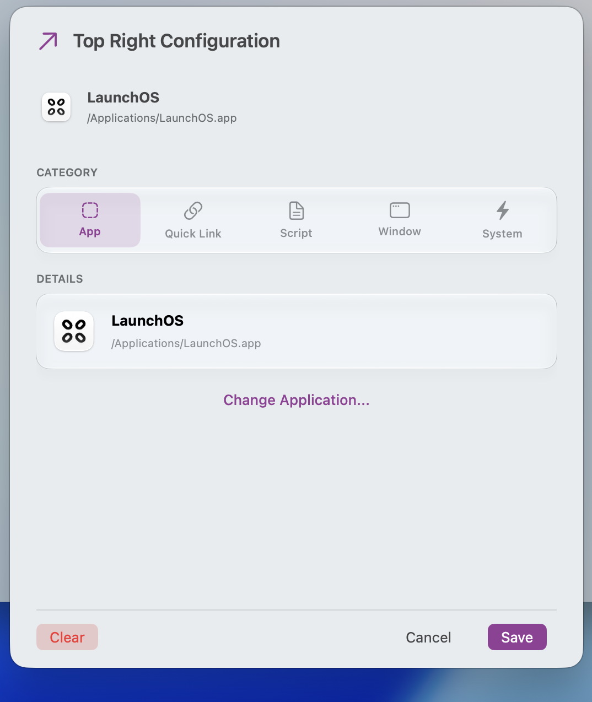

# LaunchCorner

**LaunchCorner** turns your screen corners into instant actions. Move your cursor to any screen corner to launch apps, open links, run scripts, snap windows, trigger system actions, or take screenshots — instantly. Built natively for macOS using SwiftUI, with a Liquid Glass interface on macOS 26+.

---

## Why LaunchCorner?

Hot corners are the fastest way to act on macOS — a single flick, no shortcut to remember, no window to find. But the built-in options are limited.

LaunchCorner extends every screen corner into a configurable trigger: launch apps, open links and Shortcuts, run scripts, snap windows, invoke system actions, or capture screenshots — instantly.

Native SwiftUI, Apple Silicon-optimized, background-friendly, and fully open-source under the MIT license. No accounts, no subscriptions, no tracking.

---

## Screenshots

<div align="center">
  <h5>1. Onboarding & Accessibility Permission</h5>
  
  <br /><br />

  <h5>2. Main Corner Configuration</h5>
  
  <br /><br />

  <h5>3. Per-Corner Configuration Sheet</h5>
  
  <br /><br />

  <h5>4. Settings & Sensitivity Controls</h5>
  
</div>

---

## Key Features

- **Instant Hot Corners**: Move your cursor to any of the 4 screen corners to trigger apps, links, scripts, window snaps, system actions, or screenshots.
- **Native & Ultra-Fast**: Built natively with Swift & SwiftUI for zero latency and minimal CPU/memory footprint.
- **Apple Silicon (arm64)**: Native architecture for **M1/M2/M3/M4** Macs.
- **Dwell Time & Sensitivity**: Fine-tune trigger response down to **0 ms (Instant)**.
- **Multi-Monitor Support**: Works seamlessly across multiple connected displays.
- **Runs in the Background**: Starts silently at login and hides from the Dock when closed. Open the app anytime to show its window.
- **Liquid Glass (macOS 26+)**: Translucent glass interface, with a classic-appearance opt-out in Settings.
- **Auto-Updates**: Sparkle-powered updates with automatic checks and manual Check Now.
- **Open Source**: 100% free and open-source under the MIT license.

### Corner Actions

Each corner triggers one of five categories (configured per corner in the sheet shown above, Liquid Glass UI on macOS 26+):

- **App** — launch any application.
- **Quick Link** — open a URL, `shortcuts://` Shortcut link, or file path, optionally with a specific app.
- **Script** — run a script file (Bash, AppleScript, Python, JavaScript, TypeScript, Go, Ruby, C#). Missing interpreters are flagged in the sheet with install hints (see below).
- **Window** — snap the front window to Top / Bottom / Left / Right halves or any screen quarter. Requires Accessibility access (already required by the app).
- **System** — Spotlight, play/pause/next/previous track, screen saver, lock screen, sleep display, Application Windows, plus screenshots (Fullscreen / Selection / Window → file or clipboard). Keyboard-based actions require Accessibility access; screenshots require Screen Recording access on first capture.

> **Tip**: set the matching macOS system corner to — (*System Settings → Desktop & Dock → Hot Corners…*) so both actions don't fire at once. The app reminds you the first time you configure a corner.

### Quick Link usage

A Quick Link opens anything addressable: `https://…` URLs, file paths (`~/Downloads`), app deep links (`obsidian://…`, `mailto:…`), and Apple Shortcuts (`shortcuts://run-shortcut?name=My%20Shortcut` — use the exact Shortcut name; spaces are encoded automatically). Optionally pick an app to open it with (falls back to the default handler).

### Script usage

Point a corner at a script file and pick its language (Bash, AppleScript, Python, JavaScript, TypeScript, Go, Ruby, C#). Scripts run headless in the background with a 30-second timeout; failures are logged to the Console. Missing interpreters are flagged in the sheet:

- Bash — built in (`/bin/bash`)
- AppleScript — built in (`osascript`)
- Python — install via Xcode Command Line Tools (`/usr/bin/python3`)
- JavaScript — `brew install node`
- TypeScript — `brew install tsx` (also supports `ts-node`, `deno`)
- Go — `brew install go`
- Ruby — built in (`/usr/bin/ruby`)
- C# — `brew install dotnet-script`

### Screenshot usage

Pick Kind (**Fullscreen** / **Selection** / **Window** — front window directly, no extra click) and Destination (**Copy to Clipboard** / **Save to File**). File saves default to `~/Pictures` (customizable per corner) with timestamped names; bursts can't collide. First capture triggers the macOS Screen Recording prompt (*System Settings > Privacy & Security > Screen Recording*) — without it captures are skipped, not blank.

### Settings

Gear icon top-right:

- **General** — Enable LaunchCorner (pause all corners), Launch at Login.
- **Appearance** (macOS 26+ only) — Liquid Glass on/off. Off keeps the classic look.
- **Sensitivity** — Dwell Time slider 0–500 ms. `0 ms` = Instant.
- **Updates** — Automatically check for updates (Sparkle) + Check Now.
- **App** — Quit LaunchCorner, Reset All Configurations & Permissions.
- **About** — Version, Report an Issue, GitHub links.

---

## Installation

1. Download **`LaunchCorner.dmg`** from the latest [Release](https://github.com/wenujacodes/LaunchCorner/releases).
2. Double-click `LaunchCorner.dmg` to open the installer.
3. Drag **LaunchCorner** into your **Applications** folder.
4. Open **LaunchCorner** and grant **Accessibility Access** when prompted (*System Settings > Privacy & Security > Accessibility*).

> **Note**: On first launch, if prompted by macOS Gatekeeper, right-click `LaunchCorner.app` and choose **Open** (or click **Open Anyway** in *System Settings > Privacy & Security*).

---

## Building from Source

```bash
# Clone repository
git clone https://github.com/wenujacodes/LaunchCorner.git
cd LaunchCorner

# Open in Xcode
open LaunchCorner.xcodeproj
```

To generate the installer (`LaunchCorner.dmg`) locally:
```bash
./scripts/build_release.sh
```

---

## License

Distributed under the **MIT License**. Created by [@wenujacodes](https://github.com/wenujacodes).
